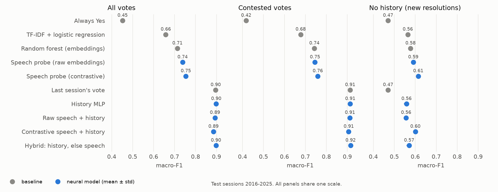
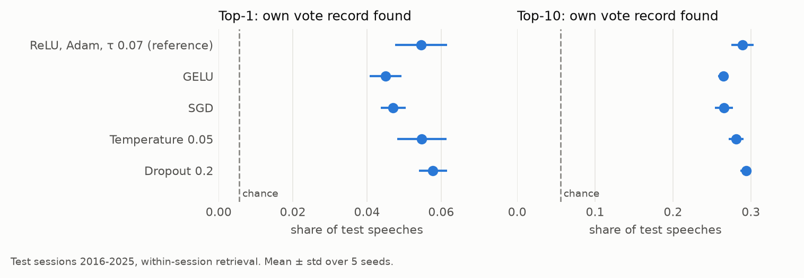
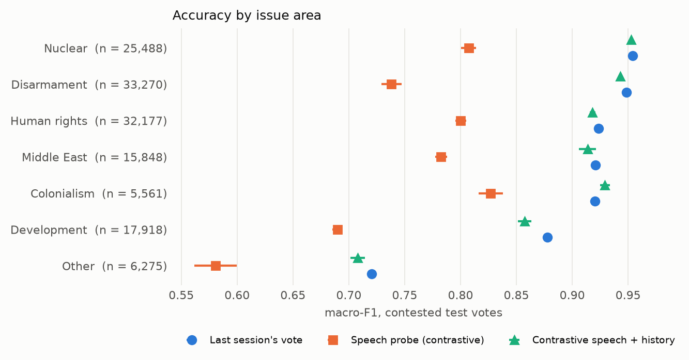
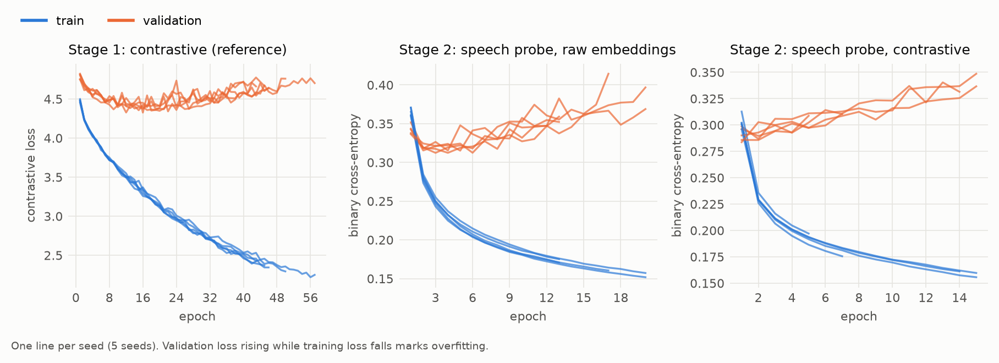

# Predicting UN Votes from General Debate Speeches

**COMP 395 – Deep Learning · Final Project · Occidental College**

Every September, each UN member state gives a speech at the General Debate laying out what it cares about. A few months later, it casts dozens of recorded votes in the General Assembly. This project tests whether **what a country says predicts how it votes**, using a contrastive model that places speeches and votes in one shared embedding space.

> **Main question:** Can a country's General Debate speech in year *t* predict its General Assembly votes in session *t*, and does it add signal beyond the country's own voting history?

**Answer, in short:** speeches carry real information about votes. A speech finds its own country's voting record about 5× more often than chance, and contrastive pretraining makes that signal more useful for prediction. But once last session's vote is known, the speech adds nothing overall. It helps only on new resolutions with no history, where speech models reach 0.61 macro-F1 against 0.56 for history.

---

## Results

All numbers are on the test sessions (2016–2025), as mean ± standard deviation over 5 seeds. Every neural model's Yes/No threshold is tuned on validation only.

### Vote prediction (macro-F1)

| Model | Uses | All votes | Contested | No history |
|---|---|---|---|---|
| Always Yes | — | 0.452 | 0.417 | 0.470 |
| TF-IDF + logistic regression | speech | 0.658 | 0.677 | 0.564 |
| Random forest | speech embeddings | 0.713 | 0.742 | 0.577 |
| `probe_no_contrastive` | speech embeddings | 0.738 ± 0.004 | 0.746 ± 0.005 | 0.590 ± 0.009 |
| `contrastive_probe` | Stage 1 speech head | **0.754 ± 0.006** | **0.759 ± 0.005** | **0.614 ± 0.005** |
| Last session's vote | history | 0.896 | 0.913 | 0.470 |
| `history_mlp` | history | **0.898 ± 0.001** | 0.914 ± 0.001 | 0.558 ± 0.012 |
| `probe_plus_history` | speech + history | 0.892 ± 0.001 | 0.912 ± 0.001 | 0.556 ± 0.008 |
| `contrastive_plus_history` | Stage 1 speech + history | 0.885 ± 0.003 | 0.906 ± 0.002 | 0.600 ± 0.005 |
| `hybrid_history_or_speech` | history, else speech | 0.897 ± 0.002 | **0.915 ± 0.001** | 0.570 ± 0.012 |

- **Contrastive pretraining helps speech-only prediction** by about 0.015 macro-F1 on every subset, roughly three standard deviations.
- **Speech does not add to history.** Adding it lowers the overall score (0.885 vs. 0.898); the models overfit to the roughly 7,400 training speeches (see the loss curves).
- **Speech helps where history is missing.** On votes with no matching resolution last session (about 18% of votes), speech models beat history by about 0.05.
- **The hybrid does not capture that gain.** Its threshold is tuned for overall macro-F1, which is dominated by votes that have history.



### Stage 1: matching speeches to vote records

Within each test session, how often does a speech find its own country's vote record among roughly 170?

| Variant | Top-1 | Top-10 |
|---|---|---|
| ReLU, Adam, temperature 0.07 (reference) | 0.055 ± 0.007 | 0.289 ± 0.015 |
| Dropout 0.2 | 0.058 ± 0.004 | 0.294 ± 0.007 |
| Temperature 0.05 | 0.055 ± 0.007 | 0.281 ± 0.010 |
| GELU | 0.045 ± 0.004 | 0.265 ± 0.007 |
| SGD | 0.047 ± 0.003 | 0.266 ± 0.012 |
| Chance | 0.006 | 0.056 |

ReLU with Adam does a little better than GELU or SGD; temperature and dropout make no clear difference.



### By issue area

On contested test votes, speeches are most informative about colonialism (0.83 macro-F1 from speech alone) and nuclear issues (0.81), and least about development (0.69). Colonialism is the only issue where adding speech to history helps (0.929 vs. 0.920); it hurts most on development (0.857 vs. 0.879).



### Training curves

Validation loss bottoms out within a few epochs while training loss keeps falling, in both stages.



---

## Data

| Dataset | What it contains | Unit we use |
|---|---|---|
| [UN General Debate Corpus](https://doi.org/10.7910/DVN/0TJX8Y) (Jankin, Baturo & Dasandi) | English text of every General Debate speech, 1946–2025 (`data/TXT/`), plus speaker metadata (`data/Speakers_by_session.xlsx`) | One speech per country per session |
| [UN General Assembly voting data](https://digitallibrary.un.org/record/4060887) (UN Dag Hammarskjöld Library) | Every recorded vote (Yes / No / Abstain) on adopted resolutions since 1946, with titles, agenda items and subject tags (`data/2026_10_15_votes_ga.csv.gz`) | One (country, resolution, vote) row |

Both are included in this repository. `un_data.py` joins them: 10,915 speeches with votes, 824,409 votes and 5,654 resolutions.

**Alignment.** The speech from the General Debate of session *t* is paired with every recorded vote in that same session.

**Splits.** Split by time, so the model never sees the future:

| Split | Sessions | Speeches | Votes |
|---|---|---|---|
| Train | 1946–2009 | 7,440 | 534,199 |
| Validation | 2010–2015 | 1,081 | 72,223 |
| Test | 2016–2025 | 1,801 | 171,726 |
| Test, held-out countries | 2016–2025 | 100 | 9,987 |

The held-out countries (Bulgaria, Bahamas, Comoros, Iraq, Iceland, Mauritius, New Zealand, Portugal, Slovenia, Yemen) never appear in training or validation, which checks that the model is not just memorising country identity.

**Contested votes.** Over 80% of votes are Yes. A resolution is *contested* when at least 10% of the votes cast on it were No or Abstain (58% of resolutions). Results are reported on all votes, on contested votes, and on votes with **no history**: those whose resolution has no counterpart in the previous session.

**History.** A resolution is matched to last session's counterpart by its title (for example "Question of Palestine"), falling back to its agenda item. The country's vote on that counterpart is its "last-session vote"; 82% of votes have one.

**Issue areas.** The vote file has no issue codes, so each resolution is tagged with six areas after Voeten's codes (Middle East, nuclear, disarmament, human rights, colonialism, development) by keywords in its title, agenda item and subject tags. 84% of resolutions get at least one tag; the rest are "other".

---

## Method

The training setup mirrors Lab 3: every experiment is a function that returns `(model, loss_fn, optimizer)`, models are built from `nn.Sequential`, and shared training loops run them all.

### Frozen text encoder, small trainable heads

A pretrained sentence-transformer (`all-MiniLM-L6-v2`, 384 dimensions) embeds each speech and each resolution **once**, and the embeddings are cached to disk. Speeches are split into chunks of whole sentences up to 150 words, embedded, then mean-pooled. Every experiment trains only small MLP heads on top.

### Stage 1: contrastive pretraining (CLIP-style)

Two `nn.Sequential` projection heads map **speeches** and **vote records** into one 128-dimensional space. A vote record is a country's voting profile for the session: its share of Yes / No / Abstain in each issue area, plus "other" and "all", 24 numbers from `vote_records()` in `un_data.py`. In a batch of *B* country-sessions, the *B × B* similarity matrix should peak on the diagonal. The loss is `nn.CrossEntropyLoss` over that matrix in both directions. **Each batch holds one session**, so the model has to match on positions rather than on era.

```python
def contrastive_relu_adam(speech_dim, vote_dim, proj_dim=128):
    """Contrastive pretraining with 2-layer ReLU heads and Adam: the reference setup."""
    model = contrastive_heads(speech_dim, vote_dim, proj_dim)  # ModuleDict: "speech", "votes"
    return model, nn.CrossEntropyLoss(), torch.optim.Adam(model.parameters(), lr=1e-3)
```

### Stage 2: vote prediction

An `nn.Sequential` head reads one (country-session, resolution) pair and outputs P(Yes) through a final sigmoid, trained with `nn.BCELoss`. Its inputs are some combination of the speech embedding (raw, or through the frozen Stage 1 speech head), the resolution embedding, and the country's last-session vote as a one-hot (Yes / No / Abstain / none). Training keeps the epoch with the best validation macro-F1.

---

## Experiments

Each experiment changes **one thing** from another.

| Experiment | What changes | Question it tests |
|---|---|---|
| `contrastive_relu_adam` | Reference setup | Baseline contrastive model |
| `contrastive_gelu_adam` | ReLU → GELU | Does the activation matter? |
| `contrastive_relu_sgd` | Adam → SGD with momentum | Does the optimizer matter? |
| `contrastive_relu_adam_t0.05` | Temperature 0.07 → 0.05 | How sharp should the contrast be? |
| `contrastive_relu_adam_dropout` | Dropout 0.2 in the heads | Are we overfitting? |
| `probe_no_contrastive` | Stage 2 only, on raw frozen embeddings | Baseline for Stage 2 |
| `contrastive_probe` | Stage 2 on the frozen Stage 1 speech head | Does contrastive training help vote prediction? |
| `history_mlp` | Stage 2 head on resolution + last-session vote, no speech | How far does history alone get with the same head? |
| `probe_plus_history` | Adds last-session vote to `probe_no_contrastive` | Do raw speech embeddings add signal beyond history? |
| `contrastive_plus_history` | Adds last-session vote to `contrastive_probe` | Do speeches add signal beyond history? |
| `hybrid_history_or_speech` | `history_mlp` where a last-session vote exists, `contrastive_probe` where it doesn't | Can speeches fill the gaps history leaves? |

### Baselines

The bar to clear is "last session's vote," not random guessing.

| Baseline | Uses speech? | Uses history? | Purpose |
|---|---|---|---|
| `always_yes` | No | No | Shows how misleading raw accuracy is |
| `last_session_vote` | No | Yes | The strong, hard-to-beat baseline |
| `tfidf_logreg` | Yes | No | Classic NLP: is deep learning needed at all? |
| `random_forest` | Yes | No | Classical model on the same cached embeddings |

### Metrics

- **Vote prediction:** macro-F1 (headline), balanced accuracy and accuracy, on all, contested and no-history votes
- **Retrieval:** top-1 and top-10 accuracy for matching a speech to its country's vote record within the same session
- **Interpretability:** macro-F1 broken down by issue area

---

## Audio case study: tone of voice vs. words

`audio_tone.py` asks whether leaders *sound* the way their words *read*, using the [UN transcription corpus](https://huggingface.co/datasets/united-nations/transcription-corpus) (CC BY 4.0). It has floor audio, the speaker's own voice, for the 2025 General Debate only.

**Method.** A small multilingual Whisper model checks the language on three clips from inside each speech; 24 of the 98 speeches labelled English turned out not to be, leaving **74 speeches**. Whisper (`small.en`) transcribes each one into 5–20 second passages. Each passage gets text sentiment ([`cardiffnlp/twitter-roberta-base-sentiment-latest`](https://huggingface.co/cardiffnlp/twitter-roberta-base-sentiment-latest)), vocal arousal, dominance and valence ([`audeering/wav2vec2-large-robust-12-ft-emotion-msp-dim`](https://huggingface.co/audeering/wav2vec2-large-robust-12-ft-emotion-msp-dim)), and pitch, loudness, pauses and speaking rate. Passages spoken by the Assembly President are removed (98 of them, leaving 6,663), and every measure is standardised within its speech.

**Findings.**
- The intensity of the voice is nearly unrelated to the sentiment of the words: arousal r = 0.06, dominance 0.05; pitch, loudness and pace are all within ±0.05.
- Only vocal valence tracks the words (r = 0.62), and the valence model partly reads the words itself, so this overstates the agreement.
- Tone barely relates to votes. Speaking rate vs. share of No/Abstain on contested 2025 resolutions gives ρ = 0.30 across countries, which is not significant after correcting for nine tests.

The corpus also holds 14 Security Council meetings, which are not used because they do not correspond to General Assembly votes.

---

## Repository layout

| File | Purpose |
|---|---|
| `un_data.py` | Join speeches and votes, build time splits, flag contested resolutions, tag issues, match last-session votes, build vote records |
| `embed_cache.py` | Compute and save speech and resolution embeddings |
| `comparison.py` | Classical baselines |
| `un_contrastive.py` | Stage 1 and Stage 2 experiment functions, training loops, multi-seed runs and logging |
| `plots.py` | Report figures from `results/` into `report/figures/` (PNG and PDF) |
| `audio_tone.py` | Audio case study: tone of voice vs. text sentiment, 2025 General Debate |
| `test_un.py` | 45 tests: data integrity, no time or country leakage, embeddings, metrics, model shapes, training loops, figures, audio pipeline |
| `data/` | Raw speeches and votes (tracked). `data/processed/`, `data/embeddings/` and `data/audio/` are generated and not tracked |
| `results/` | Generated, not tracked: `baselines.csv`, `summary.csv` (Stage 2), `retrieval.csv` (Stage 1), `by_issue.csv`, one per-epoch history CSV per experiment, and `audio/` |
| `report/figures/` | The four figures above |

---

## Getting started

Requires [uv](https://docs.astral.sh/uv/). Times are for an Apple-silicon MacBook; no NVIDIA GPU is needed.

```bash
git clone https://github.com/finlay-mcafee2005/DL-Final-Project.git
cd DL-Final-Project
uv sync

uv run python un_data.py
uv run python embed_cache.py --device mps
uv run python comparison.py
uv run python un_contrastive.py --device mps --seeds 5
uv run python plots.py
uv run pytest test_un.py -v
```

| Step | What it does | Time |
|---|---|---|
| `un_data.py` | Joins speeches and votes, builds splits → `data/processed/` | ~20 s |
| `embed_cache.py` | Caches sentence embeddings → `data/embeddings/` (downloads the encoder on first run) | ~7 min |
| `comparison.py` | Runs the four baselines | a few minutes |
| `un_contrastive.py --seeds 5` | Runs every experiment 5 times; `--experiment <name>` runs one | ~40 min |
| `plots.py` | Draws the figures | seconds |

The audio study needs extra packages and downloads about 2 GB of models plus the audio:

```bash
uv sync --extra audio
uv run python audio_tone.py --limit 3 --device mps
caffeinate -i uv run python audio_tone.py --device mps
uv run python audio_tone.py --analyze-only
```

The first command checks the setup on 3 speeches; the full run takes about 3 hours and resumes where it left off if stopped; `--analyze-only` reruns the analysis on saved results in seconds.

---

## Team and roles

| Role | Owns | Focus |
|---|---|---|
| **A: Data & baselines** | `un_data.py`, `embed_cache.py`, `comparison.py`, leakage tests | Correctness and no time leakage |
| **B: Stage 1, contrastive** | Speech and vote-record heads, contrastive experiments, retrieval metrics | A contrastive model that clearly beats chance at matching speeches to countries |
| **C: Stage 2, prediction** | Prediction head, probe and history experiments, shared training and logging code | The headline comparison against `last_session_vote` |
| **Everyone** | Evaluation, analysis, plots, report, presentation | A clear answer to the main question |

**Status:** all experiments, figures and the audio case study are done. The report is due December 8.

---

## References

- Baturo, A., Dasandi, N., & Mikhaylov, S. J. (2017). Understanding state preferences with text as data: Introducing the UN General Debate corpus. *Research & Politics*.
- Jankin, S., Baturo, A., & Dasandi, N. (2024). Words to unite nations: The complete United Nations General Debate Corpus, 1946–present. *Journal of Peace Research*.
- United Nations Dag Hammarskjöld Library. United Nations General Assembly voting data. UN Digital Library.
- Bailey, M., Strezhnev, A., & Voeten, E. (2017). Estimating dynamic state preferences from United Nations voting data. *Journal of Conflict Resolution*.
- Radford, A., et al. (2021). Learning transferable visual models from natural language supervision (CLIP). *ICML*.
- Reimers, N., & Gurevych, I. (2019). Sentence-BERT: Sentence embeddings using Siamese BERT-networks. *EMNLP*.
- Radford, A., et al. (2023). Robust speech recognition via large-scale weak supervision (Whisper). *ICML*.
- Wagner, J., et al. (2023). Dawn of the transformer era in speech emotion recognition: Closing the valence gap. *IEEE TPAMI*.
- United Nations. UN transcription corpus. Hugging Face, `united-nations/transcription-corpus`.
